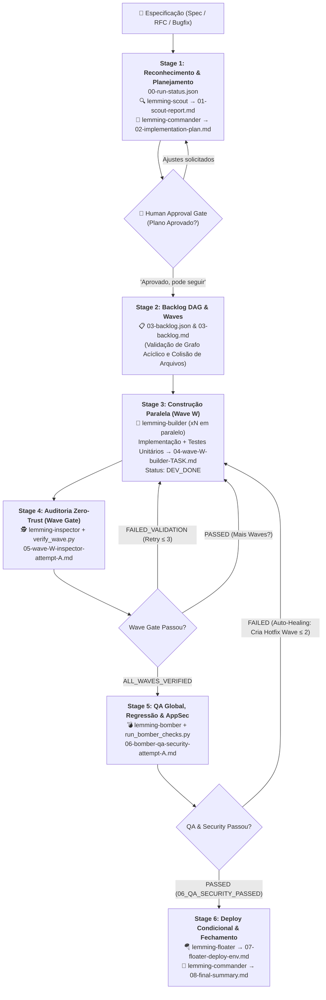
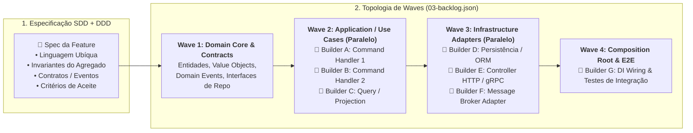

# Lemmings Squad: Engenharia Agêntica Determinística, SDD e DDD no Google Antigravity

> **Da especificação à entrega auditada em ondas paralelas:** Como transformar o desenvolvimento assistido por IA de sessões ad-hoc de *vibe coding* em uma linha de montagem multi-agente determinística, orientada a especificações (SDD), alinhada ao Domain-Driven Design (DDD) e governada por validação *Zero-Trust*.

---

## 1. Introdução: O Fim do "Agente Monolítico"

À medida que modelos de linguagem assumem tarefas cada vez mais complexas na engenharia de software, equipes que utilizam um **único agente generalista** em uma longa sessão de chat invariavelmente esbarram em quatro gargalos estruturais:

1. **Degradação de Contexto (*Context Rot*):** Após dezenas de interações lendo arquivos, rodando comandos e corrigindo erros, a janela de contexto do agente fica poluída, levando a alucinações, esquecimento de requisitos da especificação original e regressões silenciosas.
2. **Viés de Autoavaliação (*Self-Grading Bias*):** Quando o mesmo agente que escreveu o código é encarregado de revisá-lo, ele tende a validar suas próprias premissas incorretas, deixar *stubs* (`TODO`, `pass`, retornos mockados) ou criar testes superficiais que apenas confirmam o código defeituoso.
3. **Execução Sequencial e Colisão de Escopo:** Um agente monolítico altera dezenas de arquivos ao mesmo tempo sem fronteiras claras de propriedade, acoplando camadas indevidamente e inviabilizando o paralelismo seguro.
4. **Memória Efêmera de Chat:** Decisões arquiteturais, planos de implementação e relatórios de qualidade ficam presos no histórico da conversa em vez de residirem como artefatos versionáveis e auditáveis no repositório.

O **Lemmings Squad** nasce para resolver exatamente esse problema no **Google Antigravity**. Inspirado no clássico jogo *Lemmings* — onde cada criatura possui uma habilidade estritamente especializada para abrir caminho, construir pontes, inspecionar barreiras e garantir que a tropa chegue ao destino —, este plugin transforma o ciclo de vida de desenvolvimento de software (SDLC) em uma **máquina de estados determinística operada por 7 agentes especializados**.

---

## 2. O Que é o Lemmings Squad? (Skills, Protocolo e Esquadrão)

O **Lemmings Squad** é um pacote nativo para o Google Antigravity composto por **2 Skills de orquestração**, **1 Regra de Protocolo Zero-Friction**, **7 Subagentes especializados**, **1 CLI (`lemmings`)** e **1 Sidecar reativo opcional (`lemmings-watcher`)**.

### 2.1. As Skills e o Protocolo

| Componente | Arquivo | Papel no Ecossistema |
| :--- | :--- | :--- |
| **`lemmings-orchestrate`** | [`plugin/skills/lemmings-orchestrate/SKILL.md`](plugin/skills/lemmings-orchestrate/SKILL.md) | Skill principal que conduz a máquina de estados do ciclo de desenvolvimento (Stages 1 a 6), desde a leitura da especificação até a execução paralela em ondas (*Waves*), auditoria *Zero-Trust*, QA/AppSec com *Auto-Healing* e deploy em homologação. |
| **`lemmings-init`** | [`plugin/skills/lemmings-init/SKILL.md`](plugin/skills/lemmings-init/SKILL.md) | Skill de inicialização e descoberta automática do repositório. Detecta a stack, comandos de QA/build, sinais de infraestrutura/secrets (`deploy_signals`) e aciona a construção guiada de pipelines CI/CD. |
| **`lemmings-protocol`** | [`plugin/rules/lemmings-protocol.md`](plugin/rules/lemmings-protocol.md) | Regra de governança que garante **UX Zero-Friction** (o usuário interage apenas em linguagem natural), detecção automática de estado, padrão **File-First** e propriedade estrita de arquivos em execuções paralelas. |

### 2.2. Os 7 Agentes do Esquadrão

Cada agente opera sob o princípio de **Privilégio Mínimo de Ferramentas e Escopo**: agentes de leitura e auditoria são fisicamente impedidos de alterar o código-fonte da aplicação, enquanto agentes construtores só podem tocar nos arquivos alocados para sua tarefa.

| Agente | Papel no Jogo Clássico | Responsabilidade na Engenharia | Permissão no Código da App | Artefato Gerado em `.lemmings/` |
| :--- | :--- | :--- | :--- | :--- |
| **[`lemming-commander`](plugin/agents/lemming-commander.md)** | *Commander / Blocker* | **Tech Lead & Orquestrador:** Gerencia a máquina de estados, elabora o plano arquitetural, modela o DAG de tarefas em ondas e coordena os subagentes. | Orquestração | `00-run-status.json`, `02-implementation-plan.md`, `03-backlog.json`, `03-backlog.md`, `08-final-summary.md` |
| **[`lemming-scout`](plugin/agents/lemming-scout.md)** | *Scout / Climber* | **Explorador de Spec e Arquitetura:** Lê profundamente a especificação e todos os documentos/links referenciados, mapeia a arquitetura, descobre comandos de QA e analisa colisões de arquivos. | **100% Read-Only** | `01-scout-report.md` *(ou `01-scout-report-<scope>.md`)* |
| **[`lemming-builder`](plugin/agents/lemming-builder.md)** | *Builder (Construtor de Pontes)* | **Desenvolvedor Paralelo de Tasks + Testes Unitários:** Implementa uma única task do backlog em paralelo com outros Builders, escreve testes unitários e executa o `verification_cmd`. | **Restrito a `target_files` e `test_files` da Task** | `04-wave-<W>-builder-<TASK_ID>.md` |
| **[`lemming-inspector`](plugin/agents/lemming-inspector.md)** | *Inspector (Wave Gate)* | **Auditor Independente Zero-Trust:** Audita o `git diff` da onda, caça `TODO`s/*stubs*/falta de *wiring*, avalia a qualidade real dos testes e reexecuta o `verification_cmd`. | **100% Read-Only** | `05-wave-<W>-inspector-attempt-<A>.md` |
| **[`lemming-bomber`](plugin/agents/lemming-bomber.md)** | *Bomber (Teste de Carga/Impacto)* | **Especialista de QA Global, Regressão & AppSec:** Roda build, lint, typecheck, testes de regressão globais e varredura SAST/OWASP Top 10/CWE em todo o repositório. | **100% Read-Only** | `06-bomber-qa-security-attempt-<A>.md` |
| **[`lemming-floater`](plugin/agents/lemming-floater.md)** | *Floater (Pouso Seguro)* | **Especialista de Deploy Homolog/Teste & Smoke Test:** Executa *pre-flight checks* de credenciais/secrets, realiza o deploy em ambiente de validação (nunca em produção!) e roda *smoke tests*. | Execução de Deploy/Smoke | `07-floater-deploy-<env>.md` |
| **[`lemming-basher`](plugin/agents/lemming-basher.md)** | *Basher (Escavador de Túneis)* | **Arquiteto de CI/CD & Consultor de Deploy:** Escaneia variáveis de ambiente/secrets no código, gera `Dockerfile`/`firebase.json`/Git Hooks e constrói esteiras no GitHub Actions, GitLab CI ou Cloud Build. | Infra & Workflows CI/CD | `.lemmings/cicd-pipeline-report.md` + Workflows CI/CD |

---

## 3. Arquitetura do Fluxo de Execução (Máquina de Estados `00` a `08`)

O ciclo de vida de cada execução (*run*) é gravado em `.lemmings/runs/<run-id>/` e segue 6 estágios bem definidos:



---

## 4. Como isto se relaciona às Boas Práticas de Desenvolvimento Agêntico

O design do **Lemmings Squad** materializa os padrões mais avançados da **Engenharia de Software Agêntica (*Agentic Software Engineering*)**:

### 4.1. Isolamento de Contexto e Especialização de Papéis (*Context Isolation*)
Em vez de um agente acumular dezenas de milhares de tokens tentando explorar, planejar, programar, testar e fazer deploy na mesma janela de contexto, o `lemming-commander` delega cada etapa via `invoke_subagent` para subagentes com janelas de contexto limpas e instruções cirúrgicas:
- O **`lemming-scout`** foca 100% em leitura profunda e mapeamento arquitetural;
- Cada **`lemming-builder`** recebe apenas o contexto necessário para a sua `TASK-ID` específica;
- O **`lemming-inspector`** analisa friamente o código entregue na onda sem carregar o viés cognitivo das tentativas e erros durante a codificação.

### 4.2. Padrão *File-First* como Memória de Longo Prazo Determinística
Conversas de chat são voláteis; arquivos em disco são contratos duráveis. Todo estágio do Lemmings Squad persiste seu estado em arquivos numerados (`00` a `08`) validados por JSON Schemas ([`schemas/backlog.schema.json`](schemas/backlog.schema.json)).
Se a sessão do desenvolvedor for fechada no meio da Onda 2, basta abrir um novo chat e dizer *"Pode continuar com o Lemmings"*: a skill lê `00-run-status.json` e retoma exatamente do ponto onde parou, sem perder nenhuma evidência.

### 4.3. Validação Adversarial *Zero-Trust* (`DEV_DONE` $\neq$ `VERIFIED`)
Uma das regras mais importantes do protocolo ([`lemmings-protocol.md`](plugin/rules/lemmings-protocol.md)) é a **Governança de Status**:
- Um `lemming-builder` **jamais** tem permissão para marcar sua própria tarefa como `VERIFIED`. O teto de um construtor é `DEV_DONE` (uma alegação de término, não uma prova).
- Somente o `lemming-inspector`, operando em modo *read-only* sobre o código da aplicação e apoiado pelo script determinístico `verify_wave.py`, pode promover uma tarefa para `VERIFIED` ou reprová-la como `FAILED_VALIDATION` com feedback acionável de linha e arquivo.

### 4.4. Paralelismo Seguro com Propriedade Estrita de Arquivos (*Strict File Ownership*)
Para permitir que múltiplos agentes codifiquem simultaneamente na mesma *Wave* sem sobrescrever o trabalho um do outro:
1. O `state_manager.py validate-backlog` verifica matematicamente se há interseção de `target_files` e `test_files` entre tarefas da mesma onda.
2. Caso não haja colisão, os Builders rodam concorrentemente (`isolation_mode: "inherit"`). Caso haja interdependência inevitável, a onda pode operar em worktrees isoladas (`isolation_mode: "share"`).
3. As atualizações de estado em `03-backlog.json` nunca são feitas via edição direta de texto pelos subagentes, mas sim através do `state_manager.py update-task`, que utiliza bloqueio atômico de sistema operacional (`fcntl.flock`).

### 4.5. *Self-Healing Loops* com *Circuit Breakers*
Sistemas autônomos precisam saber se autocorrigir, mas também precisam saber quando parar:
- **No nível da Onda (Stage 4):** Se uma tarefa reprova na auditoria do `lemming-inspector`, apenas as tarefas com `FAILED_VALIDATION` são reenviadas ao `lemming-builder` (até `max_task_retries`, padrão `3`).
- **No nível do Repositório (Stage 5):** Se os testes unitários isolados passaram, mas a integração global ou o scanner de segurança do `lemming-bomber` detectou uma quebra ou vulnerabilidade OWASP/CWE, o `lemming-commander` cria automaticamente uma **Hotfix Wave** (`add-hotfix-wave`), aciona Builder + Inspector para corrigi-la e reexecuta o Bomber (até `max_qa_retries`, padrão `2`). Se o limite for atingido, o **Circuit Breaker** interrompe a execução e escala para o humano com diagnóstico completo.

---

## 5. Recomendação de Uso: Sistemas Modulares com SDD e Domain-Driven Design (DDD)

O **Lemmings Squad** atinge seu potencial máximo quando combinado com **Specification-Driven Development (SDD)** e **Domain-Driven Design (DDD)** em arquiteturas modulares (Monolitos Modulares, Arquitetura Hexagonal / Ports & Adapters, Clean Architecture ou Microsserviços).

### Por que SDD + DDD + Lemmings Squad formam a combinação ideal?

No **SDD**, a especificação é a fonte primária da verdade antes do código. No **DDD**, o software é modelado em torno de **Contextos Delimitados (*Bounded Contexts*)**, **Linguagem Ubíqua (*Ubiquitous Language*)**, **Agregados (*Aggregates*)**, **Objetos de Valor (*Value Objects*)** e **Eventos de Domínio (*Domain Events*)**, mantendo o núcleo de domínio desacoplado da infraestrutura.

Essa separação arquitetural resolve o maior desafio do desenvolvimento multi-agente: **como dividir o trabalho entre vários agentes em paralelo sem acoplamento caótico**.



### 5.1. Como Estruturar suas Specs SDD Orientadas a Domínio
Para extrair o melhor do `lemming-scout` (que segue recursivamente todos os links `@arquivo` e `[link](path)`), organize suas especificações refletindo os *Bounded Contexts* do seu sistema:

```text
docs/
├── architecture/
│   ├── ubiquitous-language.md       # Glossário da Linguagem Ubíqua do Domínio
│   └── context-map.md               # Mapa de Contextos e Contratos de Integração
└── specs/
    ├── billing/
    │   └── 2026-10-invoice-issuance.spec.md
    └── ordering/
        └── 2026-10-order-cancellation.spec.md
```

Dentro de cada arquivo `.spec.md`, referencie explicitamente o glossário ou contratos do módulo e declare:
1. **Contexto Delimitado (*Bounded Context*) e Linguagem Ubíqua aplicável.**
2. **Regras de Negócio e Invariantes dos Agregados** (o que nunca pode ser inválido no domínio).
3. **Casos de Uso (Application Ports)** — entradas, saídas e exceções de domínio esperadas.
4. **Adaptadores de Infraestrutura Impactados** (rotas, tabelas/índices, filas).
5. **Cenários de Teste (Given / When / Then)** que serão convertidos diretamente em `acceptance_criteria` no `03-backlog.json`.

### 5.2. A Topologia Recomendada de 4 Ondas (Waves) para DDD

Ao revisar o `02-implementation-plan.md` no *Approval Gate*, oriente (ou aprove) a divisão em ondas seguindo as camadas concêntricas do DDD:

1. **Wave 1 — Núcleo de Domínio e Contratos (*Foundation Wave*):**
   - **O que entra:** *Entities*, *Aggregates*, *Value Objects*, *Domain Exceptions*, *Domain Events* e as interfaces puras (*Ports* / *Repository Interfaces*).
   - **Por que na Wave 1:** Como todas as camadas externas dependem dos tipos e contratos do domínio, consolidar e auditar (`VERIFIED`) a Wave 1 primeiro garante que a Linguagem Ubíqua e as invariantes de negócio estejam cravadas e testadas com testes unitários puros (rápidos e zero I/O) antes que os casos de uso sejam distribuídos em paralelo.
2. **Wave 2 — Camada de Aplicação / Casos de Uso (*High-Parallelism Wave*):**
   - **O que entra:** *Use Cases*, *Command Handlers*, *Query Handlers* e *Domain Event Handlers* em arquivos separados (`src/modules/<context>/application/use-cases/...`).
   - **Por que na Wave 2:** Como os contratos da Wave 1 já existem e cada Caso de Uso reside em seu próprio arquivo (`target_files` + `test_files` totalmente disjuntos), o `lemming-commander` pode disparar **vários `lemming-builder` simultaneamente**, multiplicando a velocidade de entrega sem risco de conflito de merge.
3. **Wave 3 — Adaptadores de Infraestrutura e Entrada (*Parallel Adapters Wave*):**
   - **O que entra:** Repositórios concretos (SQL/NoSQL), clientes de APIs externas, consumidores de filas e *Controllers* REST/GraphQL/gRPC.
   - **Por que na Wave 3:** Um Builder pode implementar o repositório SQL enquanto outro implementa o Controller HTTP em paralelo, ambos programando contra as abstrações já validadas nas Waves 1 e 2.
4. **Wave 4 — *Composition Root*, *Wiring* de Módulo e Testes de Integração:**
   - **O que entra:** Registro no container de Injeção de Dependência (DI), exportação na fachada pública do módulo (`index.ts` / `__init__.py`), migrações e testes de integração entre camadas.
   - **Por que na Wave 4:** Concentra o toque em arquivos compartilhados de configuração/roteamento em uma única onda final, eliminando disputas de arquivo durante as Waves 2 e 3.

> [!TIP]
> **Escalando em Monorepos ou Múltiplos Bounded Contexts:** Quando uma especificação cruza mais de um *Bounded Context* (ex.: `ordering` emitindo um evento consumido por `billing`), o `lemming-commander` pode despachar múltiplos `lemming-scout` com escopos dedicados (`01-scout-report-ordering.md` e `01-scout-report-billing.md`), mantendo o reconhecimento de cada domínio enxuto e altamente preciso.

---

## 6. Benefícios Tangíveis: Documentação, Codificação e Testes

Adotar o **Lemmings Squad** em conjunto com SDD e DDD transforma a qualidade da engenharia em três pilares fundamentais:

### 📚 6.1. Benefícios para a Documentação (*Living & Auditable Architecture*)

| Problema Comum com IA | Como o Lemmings Squad Resolve |
| :--- | :--- |
| Documentação desatualizada ou inexistente após a entrega do código. | **Documentação *File-First* nativa:** Cada execução gera automaticamente um dossiê completo em `.lemmings/runs/<run-id>/` (`01` a `08`). |
| Falta de registro do *porquê* uma decisão técnica foi tomada. | O **`01-scout-report.md`** registra o diagnóstico arquitetural pré-código, e o **`02-implementation-plan.md`** funciona como um **ADR (Architecture Decision Record)** aprovado antes da implementação. |
| Perda da Linguagem Ubíqua (DDD) entre o produto e o código. | O `lemming-scout` lê recursivamente a especificação SDD e os glossários referenciados, propagando os termos exatos do domínio para o plano (`02`), para o backlog (`03`) e para os critérios de auditoria (`05`). |
| Revisões de Pull Request lentas e às cegas. | O **`08-final-summary.md`** e o **`03-backlog.md`** entregam ao revisor humano um mapa completo das ondas executadas, arquivos alterados por tarefa, evidências de testes e vereditos de segurança. |

### 💻 6.2. Benefícios para a Codificação (*Clean, Modular & Deterministic Code*)

| Problema Comum com IA | Como o Lemmings Squad Resolve |
| :--- | :--- |
| Agente alterando arquivos fora de escopo e quebrando módulos vizinhos. | **Propriedade Estrita de Arquivos (`target_files`):** O `lemming-builder` é proibido de tocar em qualquer arquivo não listado na sua task, preservando o encapsulamento dos módulos DDD. |
| Código incompleto com `TODO`, `FIXME`, funções vazias ou retornos *mockados*. | **Política *Zero Stubs* + Auditoria Zero-Trust:** O `lemming-inspector` executa `verify_wave.py` e inspeciona o `git diff`, reprovando imediatamente qualquer implementação incompleta ou sem *wiring* real. |
| Lentidão ao implementar features grandes com muitos casos de uso. | **Execução Concorrente em Ondas (Waves):** Múltiplos `lemming-builder` codificam casos de uso e adaptadores independentes em paralelo, reduzindo drasticamente o tempo de ciclo (*lead time*). |
| Vazamento de credenciais ou vulnerabilidades de segurança introduzidas por IA. | **Scanner Semântico e Estático no Stage 5:** O `lemming-bomber` audita todo o código modificado contra o OWASP Top 10 e CWEs (injeção, segredos hardcoded, quebra de controle de acesso) antes de liberar o fechamento da run. |

### 🧪 6.3. Benefícios para os Testes (*Multi-Layered Zero-Trust Testing*)

No Lemmings Squad, **testes não são uma etapa opcional pós-código** — eles são parte estrutural do contrato de cada tarefa no Grafo Acíclico Dirigido (`03-backlog.json`):

1. **Design Orientado a Testes desde o Backlog (Stage 2):**
   Nenhuma tarefa passa pela validação de schema (`backlog.schema.json`) sem definir explicitamente seus `test_files`, `acceptance_criteria` verificáveis e um comando determinístico `verification_cmd`.
2. **Testes Unitários de Domínio Puros e Rápidos (Stage 3 — `lemming-builder`):**
   Cada Builder é obrigado a criar ou atualizar os testes em `test_files` cobrindo o *happy path*, casos limites (*edge cases*) e invariantes de domínio, e só pode declarar `DEV_DONE` após comprovar `exit code 0` no `verification_cmd`.
3. **Auditoria Semântica Contra "Testes Falsos" (Stage 4 — `lemming-inspector`):**
   Agentes comuns costumam trapacear quando um teste falha — comentando asserções, fazendo `assert True` ou mockando a própria classe que deveria ser testada. O `lemming-inspector` lê o código dos testes em `test_files` especificamente para barrar testes superficiais e reexecuta o `verification_cmd` de forma independente.
4. **Regressão Global e Auto-Healing (Stage 5 — `lemming-bomber`):**
   Mesmo que todas as tarefas passem isoladamente, a integração entre módulos pode falhar. O `lemming-bomber` executa a bateria completa do repositório (`lint`, `typecheck`, `unit_test`, `integration_test`, `security_scan`, `build`) e, se encontrar qualquer regressão entre módulos, dispara automaticamente uma **Hotfix Wave** para corrigir o problema e adicionar o teste de regressão correspondente.
5. **Validação Pós-Deploy em Homologação (Stage 6 — `lemming-floater`):**
   Quando configurado, o fluxo fecha o ciclo executando *smoke tests* reais sobre o ambiente de `test`/`staging` recém-atualizado.

---

## 7. Guia Prático: Instalação e Como Usar

### 7.1. Instalação em 1 Comando

Na raiz deste repositório, execute:

```bash
./install.sh
```

Opções adicionais de instalação:
- `./install.sh --with-watcher`: Instala também o Sidecar reativo `lemmings-watcher` em `~/.gemini/config/sidecars/lemmings-watcher` (monitora mudanças em `.lemmings/runs/*/00-run-status.json` e dispara lembretes automáticos via `agentapi`).
- `./install.sh --target-repo /caminho/do/projeto`: Instala os agentes e skills localmente dentro de `_agents/` no repositório alvo.
- `./uninstall.sh`: Remove o plugin, o sidecar e o binário CLI de forma limpa.

---

### 7.2. Uso via Chat do Antigravity (Experiência *Zero-Friction*)

Você nunca precisa decorar nomes de scripts internos (`state_manager.py`, `verify_wave.py`) ou códigos de etapas (`00`..`08`). Basta conversar naturalmente no chat do Antigravity:

1. **Inicializar o Lemmings e/ou configurar CI/CD em um projeto:**
   > *"Inicialize o Lemmings neste projeto"*
   > *"Configure o pipeline de CI e CD deste projeto com o Lemmings"*
   *(O `lemmings-init` analisa sua stack, detecta variáveis de ambiente/secrets no código e oferece a configuração guiada com o `lemming-basher`).*

2. **Executar uma Especificação (SDD / Feature / Bugfix / Refatoração):**
   > *"Use o Lemmings para implementar a especificação em `docs/specs/billing/invoice-issuance.spec.md`"*
   *(O `lemming-commander` inicializa a run, aciona o `lemming-scout` para gerar `01-scout-report.md`, elabora o `02-implementation-plan.md` e apresenta o plano para sua aprovação).*

3. **Aprovar o Plano ou Retomar uma Run de Onde Parou:**
   > *"Aprovado, pode seguir com o Lemmings"*
   > *"Pode continuar com o Lemmings"*
   *(A máquina de estados detecta automaticamente o estágio atual em `00-run-status.json` e executa as Waves de Builders + Inspector, o QA/AppSec do Bomber, o Deploy condicional do Floater e gera o `08-final-summary.md`).*

---

### 7.3. Uso via Terminal CLI (`lemmings`)

Para automação via terminal, scripts ou integração externa, utilize o utilitário CLI instalado em `~/.local/bin/lemmings` ([`bin/lemmings`](bin/lemmings)):

```bash
# 1. Auto-descobrir stack e gerar .lemmings/config.yaml + templates customizáveis
lemmings init-config --workspace /caminho/do/projeto --with-templates

# 2. Gerar/atualizar incrementalmente esteira de CI + CD e scaffolding de infra
lemmings init-config --workspace /caminho/do/projeto --with-ci --with-cd \
  --cloud-target cloud-run \
  --scaffold-infra \
  --deploy-staging-cmd "npm run deploy:staging" \
  --smoke-staging-cmd "curl -sf https://staging.exemplo.internal/health"

# 3. Consultar o status detalhado da run atual (ondas, tasks, QA e artefatos)
lemmings status --workspace /caminho/do/projeto

# 4. Aprovar o 02-implementation-plan.md diretamente via terminal
lemmings approve --workspace /caminho/do/projeto

# 5. Disparar uma nova run via agentapi com deploy final em staging
lemmings run docs/specs/spec.md --workspace /caminho/do/projeto --deploy staging
```

---

## 8. Estrutura dos Artefatos Gerados por Run (`.lemmings/`)

Cada execução mantém uma trilha de auditoria clara e determinística dentro do repositório alvo:

```text
.lemmings/
├── config.yaml                                    # Configuração de QA, retries e política de deploy
├── config.json                                    # Espelho JSON da configuração
├── cicd-pipeline-report.md                        # Relatório de CI/CD e Pre-Flight gerado pelo lemming-basher
├── templates/                                     # (Opcional) Templates customizados de relatórios 01..08
└── runs/
    └── 20261006-invoice-issuance/
        ├── 00-run-status.json                     # Estado global da máquina de estados da run
        ├── 01-scout-report.md                     # Diagnóstico profundo da spec, arquitetura e impactos
        ├── 02-implementation-plan.md              # Plano arquitetural e estratégia de Waves (Human Gate)
        ├── 03-backlog.json                        # DAG determinístico de Waves e Tasks (validado por schema)
        ├── 03-backlog.md                          # Visualização legível do Backlog e progresso das tasks
        ├── 04-wave-1-builder-TASK-01.md           # Relatório de implementação e testes unitários da TASK-01
        ├── 05-wave-1-inspector-attempt-1.md       # Auditoria Zero-Trust da Wave 1 (Wave Gate)
        ├── 06-bomber-qa-security-attempt-1.md     # Relatório global de Build, Testes de Regressão e AppSec
        ├── 07-floater-deploy-staging.md           # Relatório de Pre-Flight, Deploy em Staging e Smoke Test
        └── 08-final-summary.md                    # Dossiê executivo final consolidado da entrega
```

---

## 9. Verificação e Testes Automatizados do Pacote

Para validar os scripts da máquina de estados, o verificador Zero-Trust de ondas, o scanner de QA/segurança e o inicializador de CI/CD deste repositório, execute:

```bash
python3 -m unittest discover -s tests -v
```
