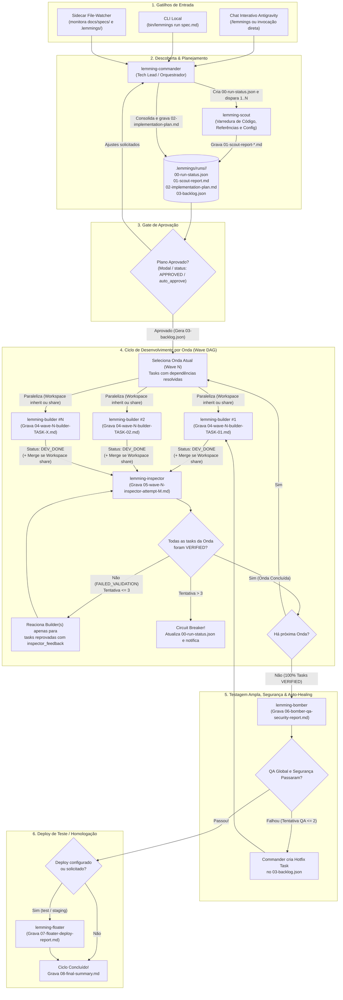
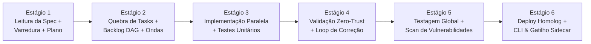

# Lemmings Squad — Especificação Geral e Plano de Implementação

> **Status:** `APPROVED_SPEC`  
> **Arquitetura Alvo:** Plugin Nativo do Google Antigravity (`plugins/lemmings-squad`) + Sidecar (`sidecars/lemmings-watcher`) + CLI (`bin/lemmings` via `agentapi`)  
> **Objetivo:** Orquestrar o ciclo ponta a ponta de desenvolvimento de software assistido por múltiplos agentes (Leitura de Spec $\rightarrow$ Varredura $\rightarrow$ Plano e Backlog DAG $\rightarrow$ Aprovação Humana $\rightarrow$ Implementação Paralela em Ondas $\rightarrow$ Validação Zero-Trust $\rightarrow$ Testagem Global com Auto-Healing $\rightarrow$ Deploy de Teste/Homologação).

---

## 1. Visão Geral e Entendimento do Problema

No desenvolvimento assistido por IA tradicional, um único agente tenta planejar, codificar dezenas de arquivos sequencialmente, declarar as próprias tarefas como prontas (muitas vezes deixando stubs, `TODOs` ou código desconectado) e encerrar sem validação independente ou garantia de não-regressão no repositório.

O **Lemmings Squad** resolve esse problema dividindo o ciclo de engenharia de software em **6 papéis especializados** inspirados nos *Lemmings* clássicos, rodando nativamente sobre a infraestrutura do **Google Antigravity** (`invoke_subagent`, isolamento de workspace `inherit`/`share`, `agentapi` e `sidecars`):

1. **Planejamento fundamentado em código real:** Antes de propor tarefas, a spec e todas as suas referências (arquivos, PRDs, schemas, URLs) são cruzadas com uma varredura profunda do repositório.
2. **Governança e Aprovação (Human-in-the-Loop):** Nenhum código de aplicação é alterado antes que o Plano de Implementação (`plan.md`) e o Backlog Estruturado (`backlog.json`) sejam aprovados (exceto quando explicitamente parametrizado com `auto_approve: true`).
3. **Execução Paralela em Ondas (Wave DAG Execution):** Tasks independentes são executadas simultaneamente por múltiplos agentes construtores, respeitando propriedade de arquivos e isolamento via Git Worktree quando necessário.
4. **Validação Zero-Trust Independente:** O agente que implementa **nunca** é a autoridade final sobre a conclusão da tarefa. Um agente validador dedicado audita o `git diff`, verifica ausência de stubs/mocks residuais e roda testes granulares antes de liberar a próxima onda.
5. **Garantia Global de Qualidade e Deploy Automatizado:** Após 100% do backlog estar verificado, uma bateria ampla de regressão (build, lint, typecheck, testes unitários/integração/E2E) é executada com capacidade de *auto-healing* antes de disparar o deploy de teste/homologação.

---

## 2. O Esquadrão: Papéis dos Agentes (Lemmings Roster)

| Agente (ID no Plugin) | Papel Clássico | Responsabilidade Principal | Ferramentas & Isolamento | Modelo Padrão |
| :--- | :--- | :--- | :--- | :--- |
| **`lemming-commander`** | **Commander** *(Tech Lead / Orquestrador)* | Ponto de entrada. Lê a spec, aciona os *Scouts*, consolida o `plan.md` e o `backlog.json`, gerencia o gate de aprovação, despacha ondas paralelas de *Builders*, aciona o *Inspector*, controla retentativas (*Circuit Breaker*) e coordena *Bomber* e *Floater*. | `invoke_subagent`, `send_message`, `manage_subagents`, `ask_question`, leitura/escrita em `.lemmings/` | `pro` / `inherit` |
| **`lemming-scout`** | **Scout** *(Codebase & Spec Explorer)* | Segue todas as referências da spec, mapeia a arquitetura do repositório alvo, descobre padrões de código, dependências afetadas e faz *auto-discovery* dos comandos de build/test/deploy caso `.lemmings/config.yaml` não exista. | Somente leitura (`view_file`, `grep_search`, `find_by_name`, `list_dir`, `read_url_content`). `Workspace: inherit` | `flash` / `inherit` |
| **`lemming-builder`** | **Builder** *(Parallel Developer)* | Recebe uma única task do `backlog.json` (ou um micro-lote coeso), implementa o código completo e testes unitários da task, executa a verificação local e marca a task como `DEV_DONE`. | Leitura + Escrita (`replace_file_content`, `write_to_file`, `run_command`). `Workspace: inherit` ou `share` | `inherit` (`pro`) |
| **`lemming-inspector`** | **Inspector** *(Zero-Trust Validator)* | Audita de forma independente todas as tasks com status `DEV_DONE` na onda atual. Inspeciona `git diff`, caça código incompleto (`TODO`, `FIXME`, funções vazias, falta de wiring) e roda `verification_cmd`. Marca como `VERIFIED` ou `FAILED_VALIDATION`. | Leitura + Execução de testes (`view_file`, `grep_search`, `run_command`) + escrita restrita ao `backlog.json`. | `pro` |
| **`lemming-bomber`** | **Bomber** *(Full QA, Regression & Security)* | Executado quando 100% das tasks do backlog estão `VERIFIED`. Roda a suíte ampla do repositório (lint, typecheck, build, testes unitários/integração/E2E) **e análise de vulnerabilidades/segurança** nas mudanças e dependências, gerando relatório para *auto-healing* se necessário. | `run_command`, `view_file`, `grep_search`, scanners de segurança/dependências. `Workspace: inherit` | `inherit` |
| **`lemming-floater`** | **Floater** *(Release & Deployer)* | Acionado após aprovação do `Bomber` se o deploy estiver habilitado (via `.lemmings/config.yaml` ou parâmetro da spec/CLI). Executa o deploy para ambiente de `test` ou `staging`/`homolog` e valida o *smoke test* / healthcheck. | `run_command`, ferramentas MCP (Cloud Run, Firebase, GKE), `read_url_content`. | `inherit` |

---

## 3. Arquitetura e Fluxo de Execução Ponta a Ponta



---

## 4. Especificação Técnica dos Componentes

### 4.1. Gatilhos de Entrada e Aprovação (Duplo Modo)

1. **Modo Interativo (Chat Antigravity):**
   - O desenvolvedor chama a skill/agente (ex: *"Commander, implemente a spec `docs/specs/auth-oauth2.md`"*).
   - O `lemming-commander` e seus subagentes **SEMPRE gravam todos os artefatos como arquivos reais dentro do repositório alvo** em `.lemmings/runs/<slug>/` (nunca retornando apenas na tela ou apenas na pasta interna do chat). No chat é exibido apenas um resumo executivo apontando para os arquivos gerados e o modal `ask_question` para aprovação.
2. **Modo Gatilho Assíncrono (Sidecar + CLI via `agentapi`):**
   - **CLI (`bin/lemmings`):** Utilitário de linha de comando que invoca `agentapi new-conversation --model=pro --title="[Lemmings] <slug>" "<prompt do Commander>"`. Suporta flags como `--spec <path>`, `--auto-approve`, `--deploy <env>`.
   - **Sidecar (`lemmings-watcher`):** Processo Python em background configurado no Antigravity que monitora:
     - Arquivos de spec adicionados ou marcados com `lemmings_status: ready` no frontmatter YAML $\rightarrow$ inicia o planejamento via `agentapi new-conversation`.
     - Arquivos `.lemmings/runs/<slug>/02-implementation-plan.md` cujo frontmatter mudou de `status: WAITING_APPROVAL` para `status: APPROVED` $\rightarrow$ envia mensagem via `agentapi send-message <conversation_id>` destravando o `lemming-commander` para iniciar a Onda 1.

### 4.2. Padrão Obrigatório de Saída em Arquivos (File-First Output Standard)

Como o Lemmings Squad pode ser acionado por **integrações automáticas, CI/CD, watchers ou outros sistemas**, **nenhum agente ou subagente pode retornar seu resultado apenas na tela do chat**. Toda etapa do ciclo gera arquivos físicos padronizados e prefixados pelo número da etapa (`00` a `08`) dentro de `<repo_alvo>/.lemmings/runs/<YYYYMMDD-slug>/`:

| Prefixo / Etapa | Padrão de Nome do Arquivo | Agente Responsável | Cardinalidade | Propósito e Conteúdo |
| :--- | :--- | :--- | :--- | :--- |
| **`00` — Run Status** | `00-run-status.json` | `lemming-commander` | 1 por run | Estado atual da máquina de estados (`current_step`, `status`, `active_subagents`, `artifacts`, timestamps) para leitura fácil por integrações externas. |
| **`01` — Reconhecimento** | `01-scout-report.md` *(ou `01-scout-report-<escopo>.md`)* | `lemming-scout` | $1..N$ por run | Relatório completo de varredura da spec, referências cruzadas lidas, arquitetura mapeada, arquivos impactados e comandos descobertos. |
| **`02` — Planejamento** | `02-implementation-plan.md` | `lemming-commander` | 1 por run | Plano detalhado de implementação em ondas, estratégia de testes, riscos e Gate de Aprovação (`WAITING_APPROVAL` $\rightarrow$ `APPROVED`). |
| **`03` — Backlog DAG** | `03-backlog.json` e `03-backlog.md` | `lemming-commander` | 1 par por run | Grafo estruturado de ondas e tasks (JSON para máquina + Markdown legível) com `target_files`, `acceptance_criteria` e `verification_cmd`. |
| **`04` — Construção** | `04-wave-<W>-builder-<TASK_ID>.md` | `lemming-builder` | 1 por task/onda | Log técnico do que o Builder implementou na task, arquivos tocados, testes unitários criados e output do `verification_cmd`. |
| **`05` — Validação** | `05-wave-<W>-inspector-attempt-<A>.md` | `lemming-inspector` | 1 por tentativa de onda | Auditoria Zero-Trust da Onda `W` (tentativa `A`): análise do `git diff`, scan de `TODO`/stubs, execução independente dos testes e veredito por task. |
| **`06` — QA & Segurança** | `06-bomber-qa-security-attempt-<A>.md` | `lemming-bomber` | $1..N$ por run | Resultado da bateria global de testes (build, lint, typecheck, unit, integração) e scan de vulnerabilidades/segurança. |
| **`07` — Deploy** | `07-floater-deploy-<env>.md` | `lemming-floater` | $0..1$ por run | Log de execução do deploy em `test`/`staging` e resultado do *smoke test* / healthcheck. |
| **`08` — Fechamento** | `08-final-summary.md` | `lemming-commander` | 1 por run | Relatório consolidado final de entrega da run com links para todos os artefatos `00` a `07`. |

#### Customização de Templates por Equipe/Repositório
Todos os arquivos acima possuem templates base em `templates/` (ex: `01-scout-report.template.md`, `02-implementation-plan.template.md`).
- Se um repositório alvo possuir uma pasta `.lemmings/templates/` (ex: `.lemmings/templates/02-implementation-plan.template.md`), os agentes utilizam **prioritariamente o template customizado do repositório**, fazendo fallback para o template padrão do plugin caso não exista.

#### Exemplo de `00-run-status.json` (Rastreamento de Etapa em Tempo Real)
```json
{
  "run_id": "20260929-user-webhooks",
  "spec_source": "docs/specs/user-webhooks.md",
  "current_step": "02_WAITING_PLAN_APPROVAL",
  "status": "WAITING_APPROVAL",
  "created_at": "2026-09-29T10:15:00-03:00",
  "updated_at": "2026-09-29T10:17:30-03:00",
  "artifacts": {
    "scout_reports": [
      ".lemmings/runs/20260929-user-webhooks/01-scout-report.md"
    ],
    "implementation_plan": ".lemmings/runs/20260929-user-webhooks/02-implementation-plan.md",
    "backlog_json": null,
    "builder_reports": [],
    "inspector_reports": [],
    "bomber_reports": [],
    "floater_report": null,
    "final_summary": null
  }
}
```

#### Exemplo de `02-implementation-plan.md` (Foco Humano e Integrações)
```markdown
---
run_id: "20260929-user-webhooks"
step: "02-implementation-plan"
spec_source: "docs/specs/user-webhooks.md"
scout_reports:
  - ".lemmings/runs/20260929-user-webhooks/01-scout-report.md"
status: "WAITING_APPROVAL" # DRAFT | WAITING_APPROVAL | APPROVED | IN_PROGRESS | COMPLETED | HALTED
auto_approve: false
deploy_target: "staging" # none | test | staging
---
# Plano de Implementação: User Webhooks

## 1. Contexto e Descobertas do Scout
- Relatório completo de varredura: [01-scout-report.md](./01-scout-report.md)

## 2. Comandos de Qualidade, Segurança e Deploy (Config / Auto-Discovery)
- **Lint/Typecheck:** `npm run lint && npm run typecheck`
- **Testes Globais:** `npm test`
- **Análise de Segurança:** `npm audit --audit-level=high` + SAST nas alterações
- **Deploy (staging):** `npm run deploy:staging`

## 3. Grafo de Execução em Ondas (Waves)
- **Wave 1 (Paralela - 2 Builders, Workspace: inherit):** `TASK-01` (Schema/Migration), `TASK-02` (Webhook Payload Types)
- **Wave 2 (Paralela - 2 Builders, Workspace: share):** `TASK-03` (Dispatcher Service), `TASK-04` (REST Endpoints)
- **Wave 3 (Sequencial - 1 Builder):** `TASK-05` (Integração E2E e Documentação)
```

#### Exemplo de `03-backlog.json` (Fonte da Verdade para os Agentes no Estágio 2+)
```json
{
  "run_id": "20260929-user-webhooks",
  "spec_path": "docs/specs/user-webhooks.md",
  "status": "WAITING_APPROVAL",
  "config": {
    "max_task_retries": 3,
    "max_qa_retries": 2,
    "qa_commands": {
      "lint": "npm run lint",
      "typecheck": "npm run typecheck",
      "test_all": "npm test",
      "security_scan": "npm audit --audit-level=high",
      "build": "npm run build"
    },
    "deploy": {
      "enabled": true,
      "environment": "staging",
      "command": "npm run deploy:staging",
      "smoke_test_url": "https://staging.api.example.com/health"
    }
  },
  "waves": [
    {
      "wave_number": 1,
      "isolation_mode": "inherit",
      "status": "PENDING",
      "tasks": [
        {
          "id": "TASK-01",
          "title": "Criar tabela e repositório de WebhookSubscriptions",
          "description": "Implementar migration SQL e classe WebhookRepository...",
          "depends_on": [],
          "target_files": [
            "src/db/migrations/004_webhooks.sql",
            "src/repositories/webhook.repository.ts"
          ],
          "acceptance_criteria": [
            "Migration cria tabela webhook_subscriptions com índices em tenant_id",
            "WebhookRepository implementa create, findByActiveEvent e deactivate",
            "Nenhum método contém TODO ou retorno mockado"
          ],
          "verification_cmd": "npx vitest run src/repositories/webhook.repository.test.ts",
          "status": "PENDING",
          "attempts": 0,
          "builder_report_file": ".lemmings/runs/20260929-user-webhooks/04-wave-1-builder-TASK-01.md",
          "inspector_history": []
        }
      ]
    }
  ]
}
```

### 4.3. Estratégia de Paralelização e Isolamento Híbrido (`inherit` vs `share`)

Ao construir o DAG de tasks no `backlog.json`, o `lemming-commander` analisa a lista `target_files` de todas as tasks que têm suas dependências (`depends_on`) satisfeitas na mesma onda (`wave_number`):

1. **Interseção de Arquivos Vazia ($\text{Files}(T_a) \cap \text{Files}(T_b) = \emptyset$):**
   - A onda é configurada com `isolation_mode: "inherit"`.
   - O Commander dispara múltiplos `lemming-builder` em uma única chamada `invoke_subagent` com `Workspace: "inherit"`.
   - Regra estrita de escopo: cada `Builder` só tem permissão de editar os arquivos listados em seu `target_files` (ou criar arquivos de teste correspondentes). Isso garante velocidade máxima e zero custo de merge.
2. **Interseção de Arquivos ou Refatoração Transversal ($\text{Files}(T_a) \cap \text{Files}(T_b) \neq \emptyset$):**
   - Sempre que possível, o Commander coloca tasks conflitantes em ondas sequenciais ($W_1 \rightarrow W_2$).
   - Caso duas tasks longas precisem rodar em paralelo e possam tocar em arquivos compartilhados (ex: `index.ts`, rotas centrais, `package.json`), o Commander invoca os `Builders` com `Workspace: "share"` (criando Git Worktrees isolados nativos do Antigravity) e realiza o merge ordenado das branches/worktrees ao término da onda antes de acionar o `Inspector`.

### 4.4. Protocolo Zero-Trust do `lemming-inspector`

Quando todos os `Builders` da Onda $N$ reportam término (`DEV_DONE`), o Commander invoca o `lemming-inspector`. O Inspector **é proibido de confiar** no `builder_summary`. Seu protocolo obrigatório de 4 etapas para cada task da onda é:

1. **Inspeção de Existência e Diff:** Verifica se todos os `target_files` existem e analisa `git diff` / conteúdo real das linhas alteradas.
2. **Varredura de Anti-Patterns (Anti-Hallucination Scan):** Usa `grep_search` e leitura direta nos `target_files` procurando por implementações falsas:
   - Comentários `TODO`, `FIXME`, `HACK`, `implement later`, `placeholder`.
   - Funções que retornam constantes vazias (`return null`, `return []`, `pass`) sem lógica real.
   - Código "órfão" (classes/funções criadas mas não exportadas ou não conectadas onde a spec exigia).
3. **Execução Independente de Testes:** Executa o `verification_cmd` da task em um terminal limpo e valida o código de saída (`exit code 0`) e o output dos testes.
4. **Veredito por Critério de Aceite:** Avalia item a item o array `acceptance_criteria`.
   - Se **100% aprovado**: atualiza a task para `"status": "VERIFIED"`.
   - Se **qualquer item falhar**: atualiza para `"status": "FAILED_VALIDATION"`, incrementa `attempts` e grava em `inspector_history` o arquivo, linha, motivo da falha e instrução exata de correção.

**Loop de Re-execução e Circuit Breaker:**
- Se houver tasks com `FAILED_VALIDATION` e `attempts < 3`, o Commander dispara imediatamente novos `lemming-builder` **apenas para as tasks que falharam**, injetando no prompt o histórico do `inspector_history`.
- Se `attempts == 3` e a task falhar novamente, o Commander muda o status da run para `HALTED`, interrompe a progressão para a próxima onda e notifica o usuário detalhando o bloqueio.

### 4.5. Configuração por Repositório (`.lemmings/config.yaml`) e Auto-Discovery

Qualquer repositório pode conter opcionalmente um arquivo `.lemmings/config.yaml` na raiz:

```yaml
version: 1
project_name: "meu-servico"

execution:
  max_parallel_builders: 4
  max_task_retries: 3
  max_qa_retries: 2
  default_approval_mode: "manual" # manual | auto

qa:
  install_cmd: "npm ci"
  lint_cmd: "npm run lint"
  typecheck_cmd: "npm run typecheck"
  unit_test_cmd: "npm run test:unit"
  integration_test_cmd: "npm run test:integration"
  security_scan_cmd: "npm audit --audit-level=high"
  build_cmd: "npm run build"

deploy:
  default_strategy: "on_param" # never | auto | ask | on_param
  environments:
    test:
      command: "npm run deploy:test"
      smoke_test_cmd: "curl -sf https://test.meu-servico.internal/health"
    staging:
      command: "npm run deploy:staging"
      smoke_test_cmd: "curl -sf https://staging.meu-servico.internal/health"
```

**Fallback de Auto-Discovery:** Se `.lemmings/config.yaml` não existir no repositório alvo, o `lemming-scout` analisa automaticamente os manifestos do projeto (`package.json`, `pyproject.toml`, `Makefile`, `Cargo.toml`, `go.mod`, `firebase.json`, `.github/workflows/*.yml`) durante a Fase 1 e preenche a seção `config` do `backlog.json` e do `plan.md` para que o desenvolvedor aprove os comandos descobertos junto com o plano.

### 4.6. Estratégia de Instalação e Empacotamento (1 Comando Agora $\rightarrow$ 1 Clique como Extension)

Para preservar **100% da performance e das features nativas do Antigravity** (`invoke_subagent`, `Workspace: share`/`inherit`, `agentapi` e `sidecars`), o projeto utiliza o formato oficial de plugins/extensões do Antigravity (`~/.gemini/config/plugins/`):

1. **Fase Atual — Clone + 1 Comando (`./install.sh`):**
   - Qualquer desenvolvedor ou equipe clona o repositório e executa um único comando:
     ```bash
     git clone <repo-url>/lemmings-squad.git
     cd lemmings-squad && ./install.sh
     ```
   - O script `./install.sh` (com suporte a `--copy` ou `--symlink` para desenvolvimento ativo, além de `./uninstall.sh`):
     - Registra o plugin em `~/.gemini/config/plugins/lemmings-squad` (contendo `plugin.json` e `gemini-extension.json` com metadados visuais, ícone e versão).
     - Registra opcionalmente o sidecar em `~/.gemini/config/sidecars/lemmings-watcher` (ativável com flag `--with-watcher`).
     - Disponibiliza o CLI `lemmings` em `~/.local/bin/lemmings`.
   - **Modo por Repositório (Opcional para Equipes):** `./install.sh --target-repo /caminho/do/projeto` copia as definições para dentro do repositório da equipe, permitindo que o time versione os agentes junto com o código se desejar.
2. **Evolução Futura — Antigravity Extension de 1 Clique (Zero Reescrita):**
   - Como o diretório `plugin/` já segue exatamente a estrutura de extensões nativas do Antigravity (mesmo padrão utilizado por extensões como `Google.securecoder.securecoder` e `modern-web-guidance-plugin`, com `plugin.json` + `gemini-extension.json`), empacotá-lo futuramente como uma **Extension de 1 clique** (`.vsix` ou catálogo de plugins do Antigravity) não exigirá alterar nenhuma linha dos agentes ou skills.

---

## 5. Estrutura de Diretórios do Repositório `lemmings-squad`

O projeto será estruturado como um pacote completo contendo o **Plugin Antigravity**, o **Sidecar**, o **CLI** e o **Instalador**:

```text
lemmings-squad/
├── README.md
├── install.sh                               # Instala/linka plugin, sidecar e CLI em ~/.gemini/config/ com 1 comando
├── uninstall.sh                             # Remove links e configurações globais de forma limpa
├── bin/
│   └── lemmings                             # CLI wrapper (run, status, approve, watch, init-config) via agentapi
├── docs/
│   └── specs/
│       └── general-spec.md                  # Este documento de especificação e plano
├── schemas/
│   ├── backlog.schema.json                  # JSON Schema para validação determinística do 03-backlog.json
│   └── lemmings-config.schema.json          # JSON Schema para .lemmings/config.yaml
├── templates/                               # Templates base (podem ser sobrescritos em <repo>/.lemmings/templates/)
│   ├── 00-run-status.template.json          # Template do manifesto de status da run e etapa atual
│   ├── 01-scout-report.template.md          # Template do relatório de exploração do Scout
│   ├── 02-implementation-plan.template.md   # Template padrão do plano de implementação
│   ├── 04-builder-report.template.md        # Template do relatório de execução do Builder (Estágio 3)
│   ├── 05-inspector-report.template.md      # Template de auditoria Zero-Trust do Inspector (Estágio 4)
│   ├── 06-bomber-report.template.md         # Template de QA global e segurança do Bomber (Estágio 5)
│   ├── 07-floater-report.template.md        # Template de deploy do Floater (Estágio 6)
│   ├── 08-final-summary.template.md         # Template do relatório final consolidado (Estágio 6)
│   └── config.template.yaml                 # Template de .lemmings/config.yaml para novos repositórios
├── plugin/                                  # Plugin Nativo do Antigravity (instalado em ~/.gemini/config/plugins/lemmings-squad)
│   ├── plugin.json                          # Manifesto nativo do Antigravity (name, displayName, version, logo)
│   ├── gemini-extension.json                # Manifesto de compatibilidade com catálogo de extensões
│   ├── assets/
│   │   └── logo.svg                         # Ícone do Lemmings Squad na UI do Antigravity
│   ├── rules/
│   │   └── lemmings-protocol.md             # Regras globais de governança de estado e propriedade de arquivos
│   ├── agents/
│   │   ├── lemming-commander.md             # Tech Lead / Orquestrador
│   │   ├── lemming-scout.md                 # Codebase & Spec Explorer (grava 01-scout-report*.md)
│   │   ├── lemming-builder.md               # Parallel Task Developer (grava 04-wave-W-builder-TASK.md)
│   │   ├── lemming-inspector.md             # Zero-Trust Task Validator (grava 05-wave-W-inspector-attempt-A.md)
│   │   ├── lemming-bomber.md                # Full QA, Regression & Security Runner (grava 06-bomber-*.md)
│   │   └── lemming-floater.md               # Staging/Test Deployer (grava 07-floater-*.md)
│   └── skills/
│       ├── lemmings-orchestrate/
│       │   ├── SKILL.md                     # Skill principal (/lemmings) com o runbook completo do Commander
│       │   └── scripts/
│       │       ├── state_manager.py         # Utilitário CLI para ler/atualizar 00-run-status.json e 03-backlog.json
│       │       └── verify_wave.py           # Helper para checar pré-condições de git diff e ondas
│       └── lemmings-init/
│           └── SKILL.md                     # Skill para inicializar .lemmings/config.yaml e .lemmings/templates/
└── sidecar/                                 # Sidecar do Antigravity (instalado em ~/.gemini/config/sidecars/lemmings-watcher)
    ├── sidecar.json
    └── lemmings_watcher.py                  # Monitora specs com gatilho e aprovações em 02-implementation-plan.md
```

---

## 6. Plano de Implementação Progressivo (Validação Estágio a Estágio)

Em vez de construir todos os agentes de uma vez e só testar no final, a implementação será feita em **6 Estágios Verticais Incrementais**. Ao final de cada estágio, você terá um fluxo funcional para testar e validar antes de avançarmos para o próximo.



---

### Estágio 1: Leitura de Spec, Varredura de Código e Plano de Implementação (`Scout` + `Commander v1`)
*Objetivo: Instalar o plugin base com 1 comando e validar se o esquadrão consegue ler uma spec real, seguir todas as referências, escanear um repositório e gravar todos os artefatos da Etapa 00, 01 e 02 em disco (`.lemmings/runs/<slug>/`).*

- [x] **TASK-1.1: Estrutura Base do Plugin e Instalador (`install.sh` / `uninstall.sh`)**
  - Criar `plugin/plugin.json`, `plugin/gemini-extension.json`, `plugin/assets/logo.svg` e `install.sh` (com cópia física padrão para evitar prompts de permissão *cross-workspace*).
- [x] **TASK-1.2: Implementar o Agente Explorador (`plugin/agents/lemming-scout.md`) e Template `01-scout-report.template.md`**
  - Configurar o `Scout` para ler a spec, seguir recursivamente todos os documentos/arquivos referenciados, mapear a arquitetura afetada, fazer *Auto-Discovery* dos comandos e **gravar obrigatoriamente em disco** `.lemmings/runs/<slug>/01-scout-report.md` (ou `01-scout-report-<escopo>.md`).
- [x] **TASK-1.3: Implementar o `lemming-commander.md` (Modo Planejamento) e Templates `00-run-status.template.json` e `02-implementation-plan.template.md`**
  - Configurar o `Commander` v1 e a skill `lemmings-orchestrate` para inicializar `.lemmings/runs/<slug>/00-run-status.json`, acionar os `Scouts`, consolidar os achados gravando `.lemmings/runs/<slug>/02-implementation-plan.md`, atualizar o `00-run-status.json` e solicitar aprovação humana.

> [!IMPORTANT]
> **Checkpoint de Validação do Estágio 1 (Como você vai testar):**
> Você passará uma spec (de feature, bugfix ou refatoração) para o `lemming-commander`. Validaremos se ele grava fisicamente no repositório alvo a pasta `.lemmings/runs/<YYYYMMDD-slug>/` contendo:
> 1. `00-run-status.json` (indicando `current_step: "02_WAITING_PLAN_APPROVAL"` e listando os arquivos gerados).
> 2. `01-scout-report.md` (gerado pelo `lemming-scout` com todas as referências lidas, arquivos impactados e comandos descobertos).
> 3. `02-implementation-plan.md` (gerado pelo `lemming-commander` com o plano em ondas e pausado aguardando aprovação).

---

### Estágio 2: Geração do Backlog de Tasks, Grafo de Ondas (DAG) e Testes Planejados (`state_manager.py` + `Commander v2`)
*Objetivo: Transformar o plano aprovado em um backlog estruturado (`03-backlog.json` e `03-backlog.md`), separando as tarefas em ondas paralelizáveis e definindo critérios de aceite e testes verificáveis por tarefa.*

- [x] **TASK-2.1: Criar JSON Schemas (`schemas/backlog.schema.json` e `lemmings-config.schema.json`) e Templates (`03-backlog.template.json` e `03-backlog.template.md`)**
  - Definir o contrato formal de cada task (`id`, `wave_number`, `depends_on`, `target_files`, `test_files`, `acceptance_criteria`, `verification_cmd`, `status`, `attempts`, `builder_report_file`, `inspector_history`).
- [x] **TASK-2.2: Implementar o Gerenciador de Estado Atômico (`state_manager.py`) + Testes Unitários (`tests/test_state_manager.py`)**
  - Criar os subcomandos `init-run`, `validate-backlog` (que valida o DAG, detecta automaticamente se há colisão de `target_files` na mesma onda para definir `isolation_mode: inherit` ou `share`, renderiza `03-backlog.md` e sincroniza `00-run-status.json`), `next-wave`, `update-task` (com file lock `fcntl.flock` e escrita atômica `os.replace`) e `check-wave-gate`.
- [x] **TASK-2.3: Evoluir o `lemming-commander.md` e `SKILL.md` para Decomposição de Tasks e Planejamento de Testes**
  - Instruir o Commander a gerar `03-backlog.json` e `03-backlog.md` garantindo que **toda task possua critérios de aceite testáveis e um `verification_cmd` explícito** (teste unitário ou comando de validação específico daquela task).

> [!IMPORTANT]
> **Checkpoint de Validação do Estágio 2 (Como você vai testar):**
> Ao aprovar o plano do Estágio 1, validaremos se o Commander gera o `backlog.json` válido segundo o schema e se o comando `python3 state_manager.py next-wave` mostra corretamente a divisão em Ondas (ex: Wave 1 com tasks independentes em paralelo, Wave 2 com tasks dependentes) e os testes planejados para cada task.

---

### Estágio 3: Implementação Paralela e Elaboração de Testes Unitários (`Builder` + Execução de Ondas)
*Objetivo: Fazer os agentes de desenvolvimento codificarem as tasks e seus testes unitários em paralelo, respeitando o isolamento de arquivos.*

- [x] **TASK-3.1: Implementar Regras de Protocolo (`plugin/rules/lemmings-protocol.md`)**
  - Definir regras estritas de propriedade de arquivos (`target_files` e `test_files`) e proibir que agentes construtores marquem tarefas como `VERIFIED` (eles só podem marcar `DEV_DONE`).
- [x] **TASK-3.2: Implementar o Agente Desenvolvedor (`plugin/agents/lemming-builder.md`) e Template `04-builder-report.template.md`**
  - Configurar o `Builder` para implementar o código da sua task, criar/atualizar os testes unitários exigidos, rodar o `verification_cmd` local, gravar `.lemmings/runs/<run-id>/04-wave-<W>-builder-<TASK-ID>.md` e atualizar o status para `DEV_DONE` via `state_manager.py`.
- [x] **TASK-3.3: Evoluir o `lemming-commander.md` e `SKILL.md` para Despacho Paralelo (`invoke_subagent`) e Merge de Worktrees**
  - Implementar no Commander o disparo simultâneo de múltiplos `Builders` por onda (`Workspace: inherit` para arquivos disjuntos e `Workspace: share` com merge ao fim da onda quando houver risco de colisão).

> [!IMPORTANT]
> **Checkpoint de Validação do Estágio 3 (Como você vai testar):**
> Executaremos uma Onda com 2 ou 3 tasks em paralelo. Validaremos se os `Builders` rodam simultaneamente sem sobrescrever o trabalho um do outro, se escrevem os testes unitários junto com o código e se todas as tasks da onda chegam ao status `DEV_DONE`.

---

### Estágio 4: Validação Independente Zero-Trust e Loop de Retentativa (`Inspector` + Circuit Breaker)
*Objetivo: Garantir que nenhuma tarefa incompleta, mockada ou sem testes passe despercebida, reacionando os Builders automaticamente quando algo falhar.*

- [x] **TASK-4.1: Implementar Helper de Auditoria (`verify_wave.py`), Template `05-inspector-report.template.md` e Agente Validador (`plugin/agents/lemming-inspector.md`)**
  - Implementar o protocolo de 4 passos do `Inspector`:
    1. Checagem de existência e `git diff` real nos `target_files` e `test_files`.
    2. Caça a anti-patterns (`TODO`, `FIXME`, funções vazias/stubs, falta de import/wiring no sistema).
    3. Execução independente do `verification_cmd` da task.
    4. Veredito por critério de aceite (`VERIFIED` vs `FAILED_VALIDATION` com `inspector_feedback` detalhado) e gravação de `.lemmings/runs/<run-id>/05-wave-<W>-inspector-attempt-<A>.md`.
- [x] **TASK-4.2: Implementar o Loop de Retentativa e Circuit Breaker no `lemming-commander.md` e `SKILL.md`**
  - Adicionar o subcomando `check-wave-gate` no `state_manager.py` e configurar o Commander para reacionar `Builders` apenas para as tasks reprovadas pelo `Inspector` (até 3 tentativas antes de acionar o Circuit Breaker e chamar o humano).

> [!IMPORTANT]
> **Checkpoint de Validação do Estágio 4 (Como você vai testar):**
> Faremos um teste forçando uma task marcada como `DEV_DONE` a conter um `TODO` ou um critério de aceite faltando. Validaremos se o `lemming-inspector` detecta a falha, recusa a task (`FAILED_VALIDATION`), o Commander reaciona o `Builder` com o feedback exato, o `Builder` corrige e o `Inspector` finalmente aprova (`VERIFIED`).

---

### Estágio 5: Testagem Ampla do Repositório, Análise de Vulnerabilidades e Auto-Healing (`Bomber`)
*Objetivo: Após todas as tasks individuais estarem verificadas, testar o repositório como um todo, auditar vulnerabilidades de segurança nas alterações e corrigir automaticamente qualquer quebra global.*

- [x] **TASK-5.1: Implementar o Agente de QA Global e Segurança (`plugin/agents/lemming-bomber.md`), Script (`run_bomber_checks.py`) e Template (`06-bomber-report.template.md`)**
  - Configurar o `Bomber` para executar em sequência:
    1. **Build, Lint e Typecheck** globais do repositório.
    2. **Suíte Completa de Testes** (unitários, integração e E2E).
    3. **Análise de Vulnerabilidades e Segurança:** auditoria de dependências (`npm audit` / `pip-audit` / scanner nativo) + revisão de segurança (OWASP Top 10 / CWEs: injeção, XSS, segredos hardcoded, falta de validação de input ou autenticação) sobre todo o `git diff` acumulado da run, gravando `.lemmings/runs/<run-id>/06-bomber-qa-security-attempt-<A>.md`.
- [x] **TASK-5.2: Implementar o Ciclo de *Auto-Healing* (Hotfix Wave) no `state_manager.py`, `lemming-commander.md` e `SKILL.md`**
  - Se o `Bomber` reportar quebra em qualquer teste de regressão do repositório ou vulnerabilidade de segurança introduzida, o Commander gera automaticamente uma onda corretiva (`Hotfix Wave`) no `03-backlog.json` (`state_manager.py add-hotfix-wave`), aciona `Builder` + `Inspector` e reexecuta o `Bomber` (até 2 ciclos).

> [!IMPORTANT]
> **Checkpoint de Validação do Estágio 5 (Como você vai testar):**
> Validaremos a execução do `lemming-bomber` ao término do backlog: ele deverá rodar todos os testes do repositório e a varredura de segurança. Testaremos também se uma regressão ou vulnerabilidade simulada dispara automaticamente uma *Hotfix Task* e é corrigida antes de dar o ciclo como pronto.

---

### Estágio 6: Deploy Condicional (`Floater`), Esteira de CI/CD (`Basher`), Config Inicializadora e Gatilhos (`CLI` + `Sidecar`)
*Objetivo: Fechar a ponta final do ciclo com deploy automatizado em homologação/teste, construção guiada de pipelines de CI/CD, configuração por repositório e acionamento por linha de comando ou file-watcher.*

- [x] **TASK-6.1: Implementar o Agente de Deploy (`plugin/agents/lemming-floater.md`) e Relatório Final (`08-final-summary.template.md`)**
  - Configurar o `Floater` para checar a política de deploy (`never`, `auto`, `ask`, `on_param`), executar o deploy no ambiente de `test` ou `staging`/`homolog`, rodar o *smoke test* / healthcheck pós-deploy, gravar `.lemmings/runs/<slug>/07-floater-deploy-<env>.md` e finalizar a run com `.lemmings/runs/<slug>/08-final-summary.md` via `state_manager.py finalize-run`.
- [x] **TASK-6.2: Implementar a Skill `lemmings-init` (`plugin/skills/lemmings-init/SKILL.md`)**
  - Criar a skill e o script `init_config.py` que analisa qualquer repositório novo e gera os arquivos `.lemmings/config.yaml` e `.lemmings/config.json` prontos para a equipe.
- [x] **TASK-6.3: Implementar o CLI (`bin/lemmings`) e o Sidecar (`sidecar/lemmings_watcher.py`)**
  - Criar o CLI `lemmings` (`run`, `approve`, `status`, `init-config`) integrando com `agentapi`.
  - Criar o Sidecar opcional que monitora specs em `.lemmings/inbox/*.md` e mudanças de `Status de Aprovação: APPROVED` no `02-implementation-plan.md`.
- [x] **TASK-6.4: Implementar o 7º Agente Construtor de Esteiras CI/CD (`plugin/agents/lemming-basher.md`) e Integração no `lemmings-init`**
  - Configurar o `lemming-basher` para auto-detectar o provedor (`github-actions`, `gitlab-ci`, `cloud-build`, `git-hooks`), preservar incrementalmente workflows existentes, gerar o pipeline de **CI** espelhado com `.lemmings/config.yaml` (Fast Feedback em commits de qualquer branch/PR + Full Bomber Gate após merge/commit na `main`) e conduzir a **entrevista guiada de CD em 3 passos** (ambientes/gatilhos, destino + smoke test, checklist de Secrets sem pedir credenciais no chat), sincronizando a seção `deploy:` do `.lemmings/config.yaml` para o `lemming-floater` e gravando `.lemmings/cicd-pipeline-report.md`.

> [!IMPORTANT]
> **Checkpoint de Validação do Estágio 6 (Como você vai testar):**
> Dispararemos a conclusão da run ou uma spec completa via chat/terminal (`lemmings status`, `lemmings init-config --with-ci --with-cd`, `lemmings run spec.md --deploy staging`) e validaremos o ciclo autônomo de ponta a ponta até o `07-floater-deploy-<env>.md`, `08-final-summary.md` e `.lemmings/cicd-pipeline-report.md`.


