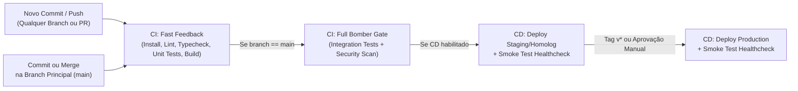

# Relatório de Pipeline CI/CD (`cicd-pipeline-report.md`)

- **Projeto:** `{{PROJECT_NAME}}`
- **Agente Construtor:** `lemming-basher`
- **Provedor de CI/CD:** `{{CI_PROVIDER}}` (`github-actions` | `gitlab-ci` | `cloud-build` | `git-hooks`)
- **Escopo Configurado:** `{{SCOPE}}` (`CI Only` | `CI + CD`)
- **Modo de Atualização:** `{{UPDATE_MODE}}` (`Created` | `Incremental Update`)
- **Timestamp:** `{{TIMESTAMP}}`

---

## 1. Arquitetura da Esteira CI/CD

---

## 2. Arquivos de Pipeline Gerados / Atualizados

| Arquivo | Tipo | Gatilhos Configurados |
| :--- | :--- | :--- |
{{PIPELINE_FILES_TABLE}}

---

## 3. Comandos Sincronizados com `.lemmings/config.yaml`

### Etapa de CI (Espelho do `lemming-bomber`)
- **Install:** `{{INSTALL_CMD}}`
- **Lint:** `{{LINT_CMD}}`
- **Typecheck:** `{{TYPECHECK_CMD}}`
- **Unit Tests:** `{{UNIT_TEST_CMD}}`
- **Build:** `{{BUILD_CMD}}`
- **Integration Tests (`main`):** `{{INTEGRATION_TEST_CMD}}`
- **Security Scan (`main`):** `{{SECURITY_SCAN_CMD}}`

### Etapa de CD (Sincronizada com `lemming-floater`)
- **Ambiente `test`:** `{{DEPLOY_TEST_CMD}}` (Smoke Test: `{{SMOKE_TEST_CMD}}`)
- **Ambiente `staging`:** `{{DEPLOY_STAGING_CMD}}` (Smoke Test: `{{SMOKE_STAGING_CMD}}`)
- **Ambiente `production` (Somente via Pipeline CD com Gate):** `{{DEPLOY_PROD_CMD}}`

---

## 4. Checklist de Secrets e Variáveis Necessárias no Repositório

> [!IMPORTANT]
> Cadastre as variáveis e segredos abaixo nas configurações do seu provedor de Git/CI (nunca comite credenciais diretamente no repositório):

{{SECRETS_CHECKLIST}}
